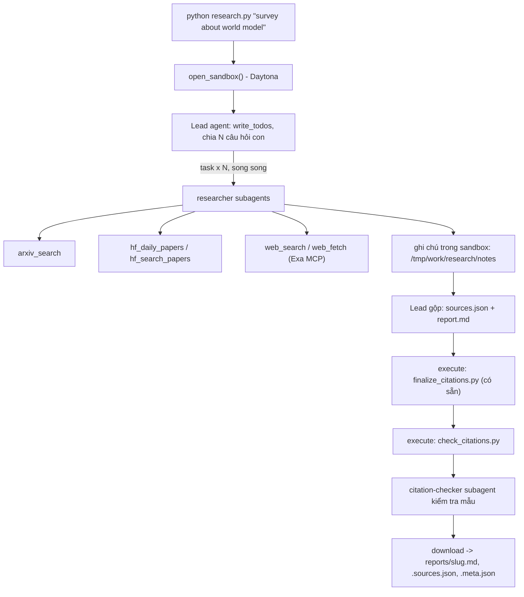

# Deep Research Agent (Deep Agents + Sandbox)

## Chạy bản đã triển khai trên Windows

Bốn module sinh viên đã được cài đặt: công cụ nguồn dữ liệu có retry, agent có giới hạn,
validator trích dẫn và luồng nghiên cứu trong sandbox. Các tệp cung cấp sẵn được giữ nguyên.
Báo cáo nộp bài phải được sinh bằng một lần chạy thật với model và sandbox đã cấu hình.

```powershell
python -m venv .venv
.\.venv\Scripts\python.exe -m pip install -r requirements.txt
# Chỉ tạo .env khi chưa có; giữ nguyên cấu hình cá nhân hiện tại.
if (-not (Test-Path .env)) { Copy-Item .env.example .env }
```

Điền tên model thật và khóa của bạn vào `.env` theo hướng dẫn bên dưới. Model phải hỗ trợ
tool calling. Chọn Daytona với `DAYTONA_API_KEY`, hoặc đặt `SANDBOX=docker` khi Docker
đã hoạt động. Công cụ arXiv/Hugging Face/Exa cần mạng ở host; sandbox chỉ xử lý tệp.
Không dán khóa vào báo cáo, ghi chú hoặc lệnh giao việc cho agent.

Kiểm tra mã trước (không cần mạng, khóa API hoặc sandbox):

```powershell
.\.venv\Scripts\python.exe -m unittest discover -s tests -v
.\.venv\Scripts\python.exe -m pip check
```

Kiểm tra 5 công cụ bằng nguồn thật, rồi chạy một chủ đề:

```powershell
.\.venv\Scripts\python.exe -X utf8 tools.py
.\.venv\Scripts\python.exe -X utf8 research.py "survey about world model"
```

Chạy đủ 5 chủ đề từ `topics.md` (dừng khi một lần chạy thất bại):

```powershell
Get-Content topics.md | ForEach-Object {
    if ($_ -match '^\d+\.\s+(.+)$') {
        $researchTopic = $Matches[1]
        & .\.venv\Scripts\python.exe -X utf8 research.py $researchTopic
        if ($LASTEXITCODE -ne 0) { throw "Research failed: $researchTopic" }
    }
}
.\.venv\Scripts\python.exe self_check.py
```

Mỗi lần chạy thành công tạo `reports/<slug>.md`, `.sources.json`, `.meta.json`.
Hai tệp đầu giữ đúng byte tải về từ sandbox. Metadata ghi topic, model, thời gian,
số lần gọi task/tool, token của lead, số nguồn và họ nguồn; token của subagent chưa
được tính vào con số này. Lead có giới hạn 150 model calls/300 tool calls; researcher
40/60; citation-checker và helper nội bộ 20/30. Graph lead có `recursion_limit=1000`.

Finalizer và validator chạy trong sandbox trước khi tải về. Lần chạy thiếu báo cáo,
trích dẫn lỗi, ít hơn 3 task hoặc ít hơn 3 họ nguồn sẽ trả mã lỗi 1. Chủ đề rỗng trả
mã 2. Không sửa tay báo cáo để vượt kiểm tra: sửa mã/prompt rồi chạy lại.

CLI hiển thị tên công cụ và số lượt model của toàn bộ agent để theo dõi tiến độ;
không in prompt, input công cụ hoặc cấu hình chứa khóa. `-X utf8` giúp terminal
Windows hiển thị được Unicode trong tên bài báo và ký hiệu toán học. Khi finalizer
hoặc validator thất bại, lỗi kèm thông báo cuối của lead để hỗ trợ chẩn đoán.

Với OpenAI, khi model chưa đặt cấu hình riêng, client dùng timeout 120 giây cho mỗi
request và tối đa 1 lần retry. Cấu hình timeout/retry đã đặt được giữ nguyên.
Prompt yêu cầu báo cáo tiếng Anh với giọng junior, dùng “I” cho nhận xét của người
viết và ghi rõ số liệu là kết quả tác giả công bố. Việc chỉnh giọng diễn ra trong
sandbox trước khi kiểm tra trích dẫn và tải về.

## Báo cáo đã sinh

Đã chạy thật cả 5 chủ đề với model cấu hình trong `.env` và Daytona. Mỗi báo cáo
đi kèm `.sources.json` để tra nguồn và `.meta.json` để đọc thống kê lần chạy.
Đã đọc báo cáo, đối chiếu trích dẫn mẫu và mở thêm 5 URL mỗi chủ đề với nguồn gốc.
Chi tiết phạm vi kiểm tra tại [CITATION_REVIEW.md](CITATION_REVIEW.md).

| Báo cáo | Số nguồn | Lượt subagent | Họ nguồn |
|---|---:|---:|---:|
| [World model](reports/survey-about-world-model.md) | 14 | 4 | 4 |
| [Reinforcement learning for LLM reasoning](reports/survey-about-reinforcement-learning-for-llm-reasoning.md) | 15 | 5 | 3 |
| [LLM agents and tool use](reports/survey-about-llm-agents-and-tool-use.md) | 14 | 6 | 4 |
| [Video and multimodal generation](reports/survey-about-video-and-multimodal-generation.md) | 22 | 6 | 4 |
| [Efficient inference and small language models](reports/survey-about-efficient-inference-and-small-language-models.md) | 16 | 5 | 3 |

`python self_check.py` kiểm tra cả 5 báo cáo và báo `READY to submit`.
29 kiểm thử offline đạt; `pip check` không phát hiện lỗi phụ thuộc.

`self_check.py` báo thiếu báo cáo khi chưa chạy đủ 5 chủ đề; kiểm thử offline thành công
không đồng nghĩa bài đã sẵn sàng nộp. Sau khi kiểm tra nguồn mẫu, commit mã và `reports/`
lên public repo của bạn; `.env` luôn nằm ngoài Git.

Lab dựng một **hệ thống deep research đa tác tử**: người dùng chỉ cần nhập một chủ đề (ví dụ `survey about world model`), hệ thống tự lập kế hoạch, giao việc cho nhiều subagent, tìm tài liệu trên arXiv, Hugging Face và web, rồi viết một **báo cáo có trích dẫn**.

Hình thức: **bài thực hành cá nhân**. Ngôn ngữ lập trình: Python 3.11 trở lên.

## 1. Mục tiêu học tập

Sau lab, bạn có thể:

1. Dựng agent bằng thư viện Deep Agents (LangChain): công cụ (tool), system prompt, subagent, backend.
2. Dùng **sandbox** (Daytona) làm không gian làm việc và nơi chạy mã cho agent; hiểu vì sao khóa API và công cụ mạng phải nằm ở phía host chứ không nằm trong sandbox.
3. Viết công cụ gọi API ngoài **chịu được giới hạn tốc độ** (retry, backoff, jitter, `Retry-After`).
4. Thiết kế quy trình đa tác tử: lead chia nhỏ câu hỏi, giao cho N researcher chạy song song, tổng hợp và kiểm tra trích dẫn.
5. Tạo báo cáo có thể kiểm chứng: mọi khẳng định có `[n]` trỏ tới một nguồn có thật.

## 2. Hệ thống làm gì



Nguồn dữ liệu:

| Nguồn | Dùng để |
|---|---|
| arXiv API `https://export.arxiv.org/api/query` | Tìm bài theo từ khóa, sắp theo ngày |
| Hugging Face Daily Papers `/api/daily_papers` | Bài đang "trending": upvotes, githubRepo, summary |
| Hugging Face papers search `/api/papers/search?q=` | Tìm bài theo chủ đề |
| Web qua Exa MCP (`web_search_exa`, `web_fetch_exa`) | Blog, survey, trang dự án, nội dung đầy đủ của một URL |

## 3. Cấu trúc thư mục

```
Lab/
├── README.md  GUIDE.md  RUBRIC.md  REPORT_TEMPLATE.md   tài liệu
├── topics.md                 5 chủ đề cần chạy
├── requirements.txt  .env.example  .gitignore
├── model.py                  CÓ SẴN - không sửa: tạo mô hình LLM từ biến môi trường
├── sandbox.py                CÓ SẴN - không sửa: sandbox Daytona (hoặc Docker), upload, download
├── self_check.py             CÓ SẴN - không sửa: tự kiểm tra trước khi nộp (python self_check.py)
├── finalize_citations.py     CÓ SẴN - không sửa: script chạy trong sandbox, tự sinh `## References` và đánh số lại trích dẫn
├── tools.py                  SINH VIÊN CÀI ĐẶT: retry + 5 công cụ nguồn dữ liệu
├── agents.py                 SINH VIÊN CÀI ĐẶT: prompt, subagent, lead agent
├── research.py               SINH VIÊN CÀI ĐẶT: script chính
├── check_citations.py        SINH VIÊN CÀI ĐẶT: kiểm tra trích dẫn, chạy TRONG sandbox
└── reports/                  báo cáo sinh ra (bạn commit vào repo nộp)
```

Mỗi tệp "SINH VIÊN CÀI ĐẶT" là **pseudo-code chạy được** (import được): các hàm có docstring mô tả việc cần làm, các `TODO n` đánh số theo `GUIDE.md`, thân hàm đang `raise NotImplementedError`.

## 4. Cài đặt

```bash
python3 -m venv .venv && source .venv/bin/activate      # Python 3.11+
pip install -r requirements.txt
cp .env.example .env                                     # rồi điền khóa CỦA BẠN
```

Bạn cần ba loại khóa (điền vào `.env`, **không bao giờ commit** `.env`):

| Khóa | Lấy ở đâu | Ghi chú |
|---|---|---|
| LLM (`LAB_MODEL` + khóa nhà cung cấp) | Nhà cung cấp bạn chọn (OpenAI, Anthropic, Google, OpenRouter, Ollama...) | Mô hình **phải hỗ trợ tool calling**. Chép tên mô hình từ tài liệu của nhà cung cấp. |
| `DAYTONA_API_KEY` | https://app.daytona.io | Kiểm tra gói miễn phí / credit hiện hành. Không có tài khoản hoặc hết credit: đặt `SANDBOX=docker` để chạy sandbox trong container Docker cục bộ (xem `.env.example`). |
| `EXA_API_KEY` (khuyến nghị) | https://dashboard.exa.ai/api-keys | Có thể chạy không khóa, nhưng bản miễn phí của MCP bị giới hạn tốc độ rất nhanh. |

## 5. Làm bài

Làm theo thứ tự (chi tiết trong `GUIDE.md`):

1. `check_citations.py`: khởi động nhẹ, thuần Python.
2. `tools.py`: viết `with_retry` và 5 công cụ. Thử riêng từng công cụ: `python tools.py`.
3. `agents.py`: viết prompt, subagent và lead agent.
4. `research.py`: ghép tất cả; chạy một chủ đề:

```bash
python research.py "survey about world model"
```

Kết quả nằm ở `reports/survey-about-world-model.md` cùng `.sources.json` và `.meta.json`.

## 6. Chủ đề và nộp bài

- Chạy đủ **5 chủ đề** trong [`topics.md`](topics.md), mỗi chủ đề một lần.
- Commit mã nguồn và toàn bộ `reports/`, đẩy lên một **public repo** GitHub và nộp link.
- Kiểm tra trước khi nộp: chạy **`python self_check.py`** (không tốn token): nó kiểm tra đủ 5 báo cáo, `meta.json`, trích dẫn bằng `check_citations.py` của bạn, và không có `.env`/khóa nào trong git.
- Cách chấm: xem [`RUBRIC.md`](RUBRIC.md).

## 7. Thời gian, chi phí và an toàn

- Dùng một mô hình **rẻ nhưng hỗ trợ tool calling**, và **đặt giới hạn** (số lần gọi mô hình/công cụ cho lead và subagent, `recursion_limit`): một prompt hỏng có thể khiến agent lặp rất lâu. Đây là hạng mục 2.5 của `RUBRIC.md`.
- Kết quả có tính ngẫu nhiên: cùng một mã có thể cho báo cáo hợp lệ ở lần này và trích dẫn lỗi ở lần sau. Hãy sửa **prompt và mã**, không sửa tay báo cáo.

- Mỗi lần chạy tốn token LLM và thời gian sandbox. `tokens` trong `meta.json` chỉ đếm tin nhắn của lead, chưa gồm subagent, nên chi phí thật cao hơn. `open_sandbox()` luôn dừng và xóa sandbox khi kết thúc, kể cả khi lỗi. Đừng bỏ qua nó.
- **Không đưa bí mật vào sandbox.** Sandbox không ngăn được prompt injection hay việc đẩy dữ liệu ra mạng; một trang web độc hại có thể khiến agent chạy lệnh bên trong sandbox. Vì vậy mọi công cụ gọi mạng và mọi khóa ở lại phía host.
- Nội dung lấy từ web là **dữ liệu không đáng tin**: agent không được làm theo chỉ dẫn nằm trong đó.
